<div align="center">

# Project Ronin

### *Reclaim your hardware. A one-click optimization suite for Windows 11.*

[](https://github.com/keiretrogaming/Project-Ronin/releases)
[](https://github.com/keiretrogaming/Project-Ronin/releases/latest)


[](LICENSE)

</div>

I built Project Ronin because I got tired of fighting my own computers. I've used great tools like WinUtil and Ultimate Windows Tweaker for years, but none of them had *everything* I wanted in one place. I kept bouncing between three apps just to repair Windows, check SSD health, and clear out a bloated GPU driver cache. So I made the tool I actually wanted.

It also had to look the part. The whole UI is retro-cmd, cyberpunk styled. Nostalgic on the surface, modern underneath.

The name is the point. A ronin is a masterless samurai. You bought your hardware, so you're the one who should control it, not Microsoft. You paid for the silicon, you should get all of it.

Everything runs through official **Group Policies** and **registry flags**, so your system stays stable, secure, and every change can be undone.

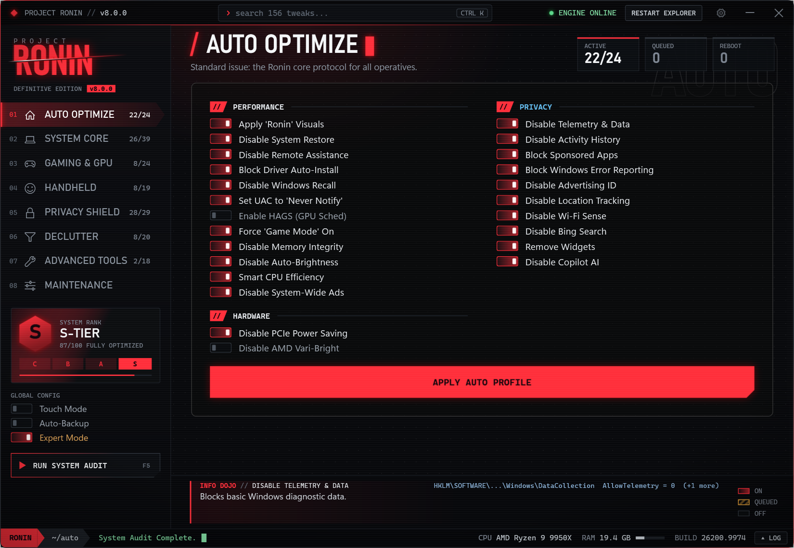

<div align="center">

**[Download the latest release](https://github.com/keiretrogaming/Project-Ronin/releases/latest)**

</div>

---

## ✨ New in 8.0

* **A new look.** Sharper red-on-black terminal style. Every tab gets a header with live **ACTIVE / QUEUED / REBOOT** counters, there's a rank card, search across every tab (**Ctrl+K**), and a status bar with the latest message, CPU and RAM. Every font ships with Windows 11, so nothing is bundled.
* **Declutter tab.** Ads, nags and surprise restarts out: Start recommendations, search highlights, lock-screen tips, account nags, a quieter Edge, plus quality-of-life switches like battery percentage, always-visible scrollbars and Num Lock at startup.
* **Windows Update control.** No surprise restarts, pause updates for 5 weeks, or (Expert Mode) turn them off with a reminder every 30 days. It uses Windows' own pause, so Settings' "Resume updates" button always works.
* **Startup Apps, Install Apps and Windows Tools.** Task Manager's own startup switches in one list; 43 checked apps (browsers, game launchers, tools, game runtimes) installed silently through Microsoft's winget, only when you confirm; and one-click shortcuts to the classic Windows tools.
* **See before you apply, undo anything.** Apply shows you what will change first. Maintenance → **Changes by Ronin** lists everything Ronin changed on your PC, each with an Undo button, and every undo puts back *your* original setting.
* **Ronin notices when Windows undoes your tweaks** after a big update, and offers to re-apply them.
* **Steadier.** A watchdog that tells you when something stops responding, one-click bug reports, and a long list of fixes. Everything is in the [changelog](CHANGELOG.md).

Coming from 7.4? 7.5 and 7.6 were never released on their own, so they're all in here too.

---

## Disclosure

I've wanted to build something like this for years, but programming syntax never clicked for me. I used an LM to bridge that gap. I didn't just copy-paste and hope for the best, though. Every tweak is cross-referenced against trusted sources like *ElevenForum* and *WinUtil*, and I run all of them on my own hardware: an **MSI Claw 8 AI**, a **2023 and 2025 Zephyrus G14**, and two custom desktops.

Stability and transparency come first. And yes, there's a certain irony in using AI to rip the unwanted AI out of Windows. It works anyway.

---

## ⚠️ Read This Before Tweaking

Most of the scary stuff from older versions is now handled by the app itself, but you should still know how Windows behaves:

* **Apply takes two clicks.** The first click is a preview: the button turns **amber** and says how many settings will change ("CLICK AGAIN: APPLY 12 CHANGES"), and the console lists them. Click it again to apply. It waits for you, so if nothing seems to happen, look for the amber button. Prefer one click? Settings (gear icon) → untick *Preview changes before applying*.

* **BitLocker decryption takes time.** Turning off Device Encryption (Handheld tab) decrypts your drive in the background, anywhere from 10 minutes to an hour depending on your SSD. Ronin shows a live **"DO NOT RESTART - DECRYPTING DRIVE [X%]"** banner and warns you if you try to close the app mid-decrypt. The rule still stands: **don't reboot until it hits 100%**, or you'll trip a BitLocker recovery screen (the infamous black/sideways screen on handhelds).

* **Core Isolation & VMP are guarded now.** Toggling Memory Integrity (HVCI) or the Virtual Machine Platform while your drive is encrypted can lock you out on the next boot. Ronin automatically **skips these tweaks while BitLocker is active**, so you can't shoot yourself in the foot. Decrypt first, then toggle.

* **The Hot-Bag interlock.** The Hot-Bag Fix (power button = Hibernate) needs Windows Hibernation enabled. If you've disabled Hibernation in the System tab, Ronin locks the Hot-Bag toggle and tells you why instead of letting it half-apply.

* **Removed apps don't come back on their own.** App removals in the Debloat Center are the one thing Ronin can't undo. They're listed (with the date) in Maintenance → Changes by Ronin; reinstall them from the Microsoft Store.

---

## 📥 Installation

Windows blocks files downloaded from the internet, and some antivirus side-eyes any system tweaker. Two steps and you're past all of it:

**1. Unblock the zip *before* extracting.**
Right-click the downloaded `.zip` → **Properties** → tick **Unblock** at the bottom → **OK**. *Then* extract it. Doing it in this order clears the block on every file inside at once, so you never have to unblock anything one by one.

> Already extracted? No problem. Open the folder, type `powershell` in the address bar, hit Enter, and run:
> ```powershell
> Get-ChildItem -Recurse | Unblock-File
> ```

**2. Run it.**
Right-click **`Launch_Ronin.bat`** → **Run as administrator**. If a blue "Windows protected your PC" box pops up, click **More info → Run anyway**. That's standard for any new unsigned app.

A minimised **Project Ronin** console also appears on your taskbar. That's the launcher: leave it alone, it closes with Ronin.

The launcher loosens the execution policy for that one window only. No permanent changes to your system, and everything Ronin does is reversible from inside the app.

---

## 🛡️ The Non-Destructive Optimization Policy

Trust is built on transparency and the ability to roll back:

* **Automatic Restore Points:** With Auto-Backup on, Ronin triggers a system restore point before major modifications (and tells you plainly if Windows can't make one).
* **Your Originals, Restored:** Before changing a setting, Ronin records what *your* PC had, and every undo puts exactly that back, then checks that it did. "Undo all changes" only touches what Ronin changed, never settings you chose yourself.
* **Policy-Based Tweaks:** Group Policy and official registry flags. Windows treats these as intended settings, not corruption.
* **Non-Destructive:** Nothing in `System32` gets deleted. Want Copilot or the Snap flyout back? Toggle it back on.
* **Hardware Aware:** Ronin checks your hardware on launch. It won't push NVIDIA latency tweaks to an AMD handheld.

---

## 🕹️ Core Modules

| Module | Purpose | Key Tweaks |
| --- | --- | --- |
| **Auto-Optimize** | My Personal Baseline | Safe, high-impact defaults I put on every new machine I build. *(That's the screenshot at the top.)* |

| Module | Purpose | Key Tweaks |
| --- | --- | --- |
| **System Core** | UI & Background | Fixes "Ghost Sleep," removes Start Menu ads, and streamlines Explorer. |

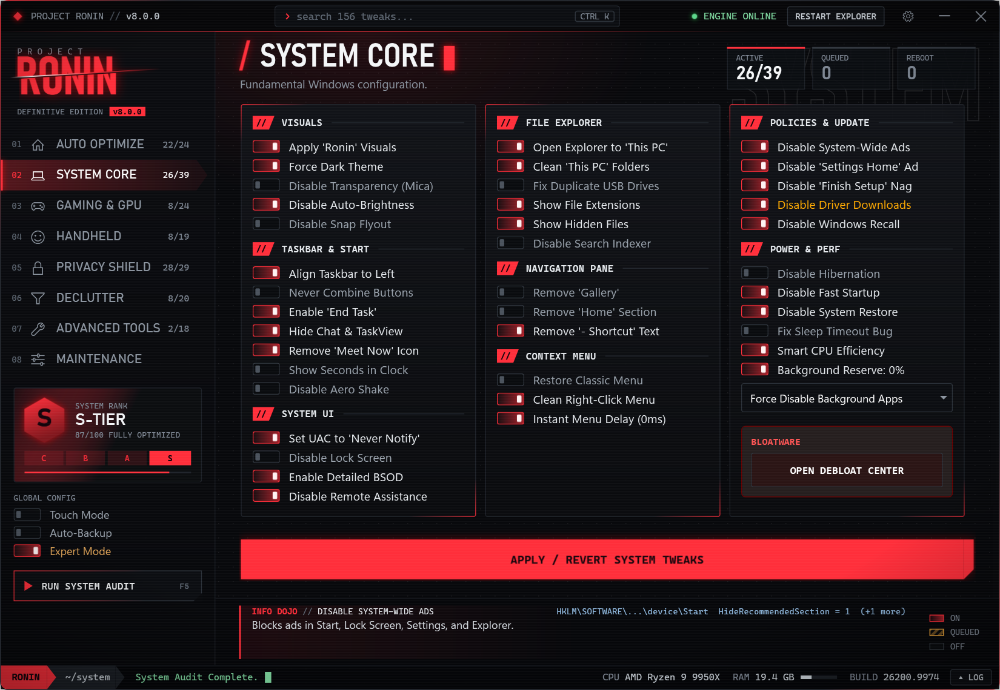

| Module | Purpose | Key Tweaks |
| --- | --- | --- |
| **Gaming & GPU** | Latency & Stability | Sets HAGS/VRR flags and safely disables MPO to prevent flickering. |

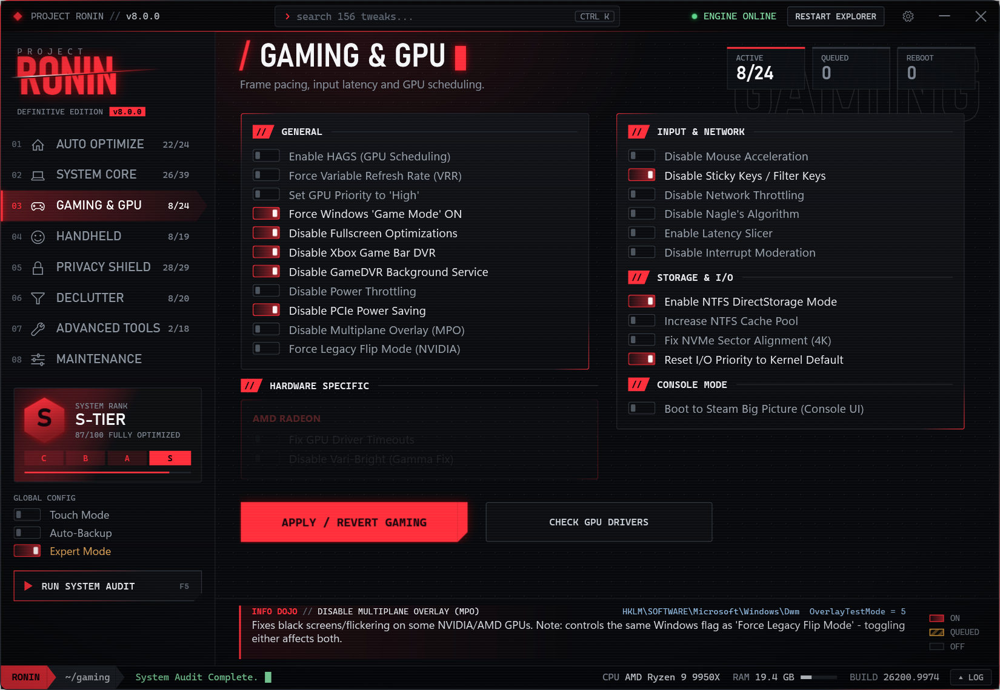

| Module | Purpose | Key Tweaks |
| --- | --- | --- |
| **Handheld** | Portable Devices | **Essential for x86 Handhelds.** Fixes "Hot-Bag" issues by forcing Hibernate, disables encryption/VBS for APU gains, and checks battery health. |

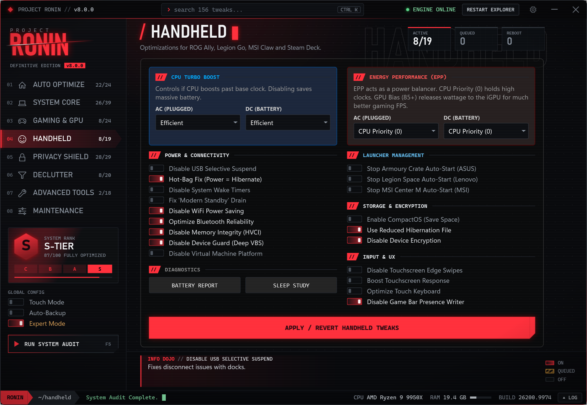

| Module | Purpose | Key Tweaks |
| --- | --- | --- |
| **Privacy Shield** | De-AI Windows | Strips out Recall AI, Copilot, and aggressive telemetry data-mining. |

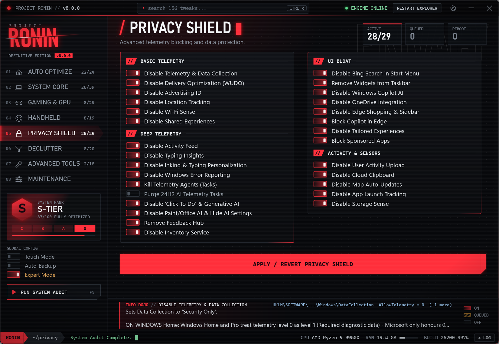

| Module | Purpose | Key Tweaks |
| --- | --- | --- |
| **Declutter** *(new)* | Ads, Nags & Updates | Kills Start, Settings and lock-screen ads and nags, quiets Edge, controls Windows Update restarts and pauses, and hosts Startup Apps, the Debloat Center, Install Apps and shortcuts to the classic Windows tools. |

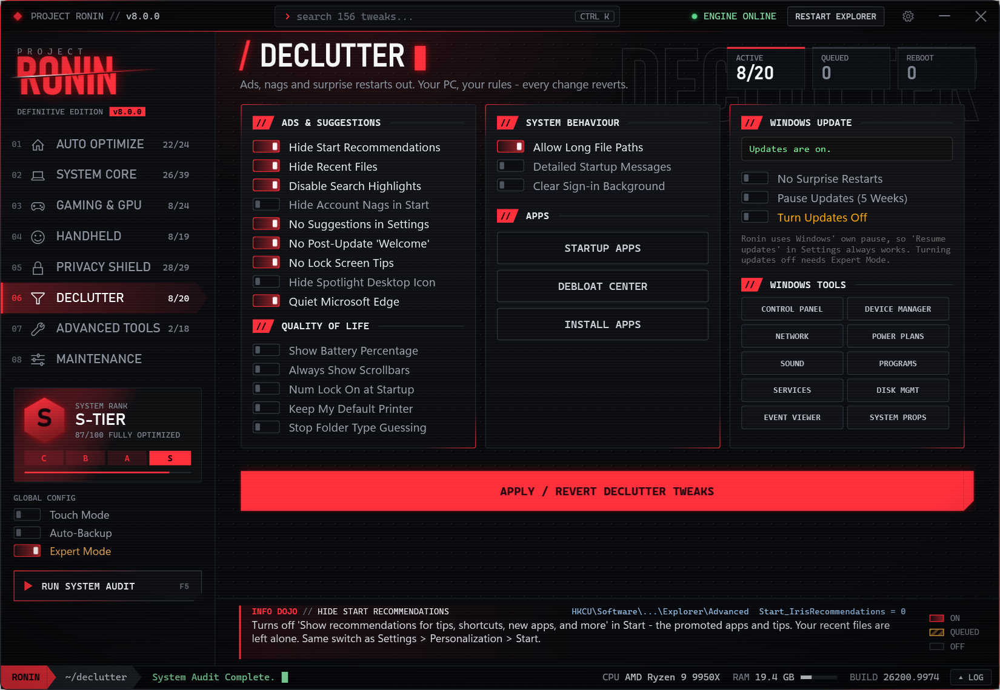

| Module | Purpose | Key Tweaks |
| --- | --- | --- |
| **Advanced Tools** | Power Users | Windows features on demand (.NET 3.5 and DirectPlay for older games, Hyper-V, WSL), the Ultimate Performance plan, timer and memory tuning. Even blocks WPBT, the firmware trick vendors use to auto-install their software on clean installs. |

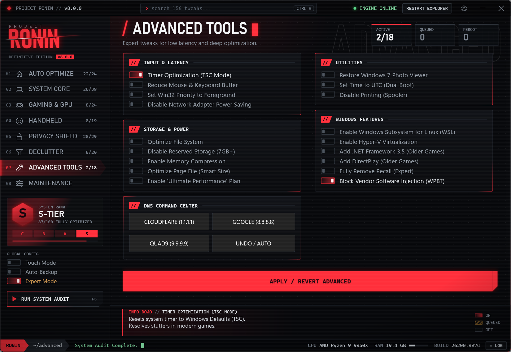

| Module | Purpose | Key Tweaks |
| --- | --- | --- |
| **Maintenance** | Diagnostics | My one-click cure-all. Repairs the Windows image, resets MS Store, clears GPU caches, audits SSD health, and the **Reclaim Space** deep clean typically frees 15-30+ GB. **Changes by Ronin** lists everything Ronin did, with an Undo for each. |

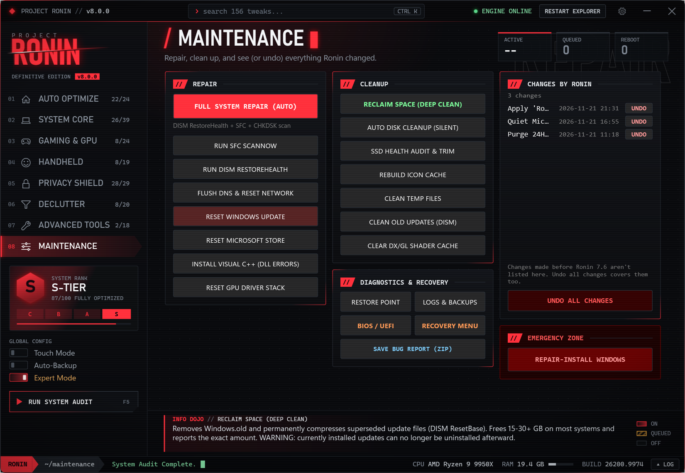

### Built-in tools

<p align="center">
  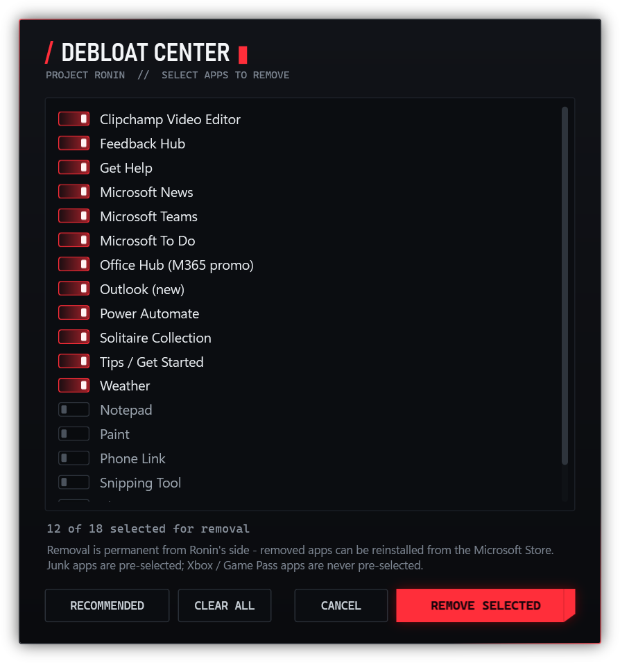
  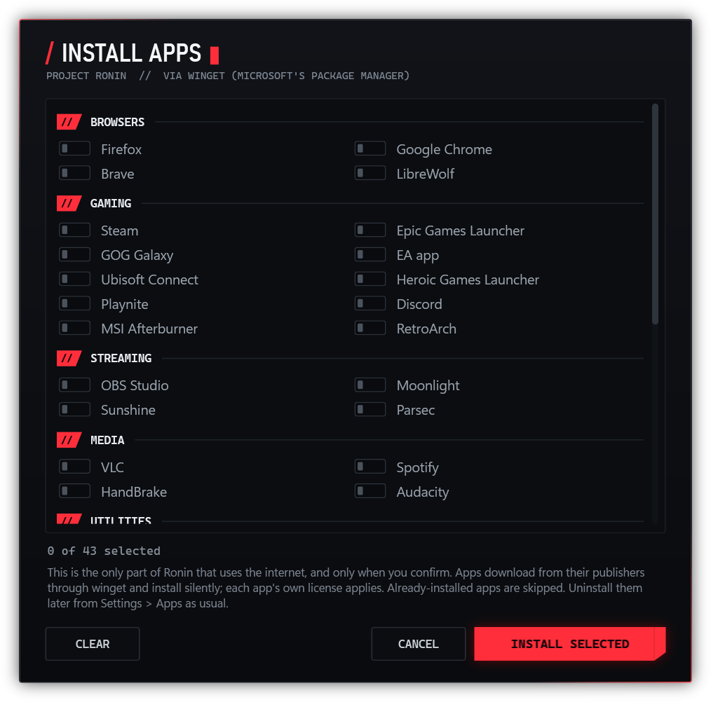
</p>

**Debloat Center** removes the preinstalled junk (pre-selected; Xbox and Game Pass apps never are). **Install Apps** sets up a fresh PC in one go through Microsoft's winget, and only goes online when you confirm.

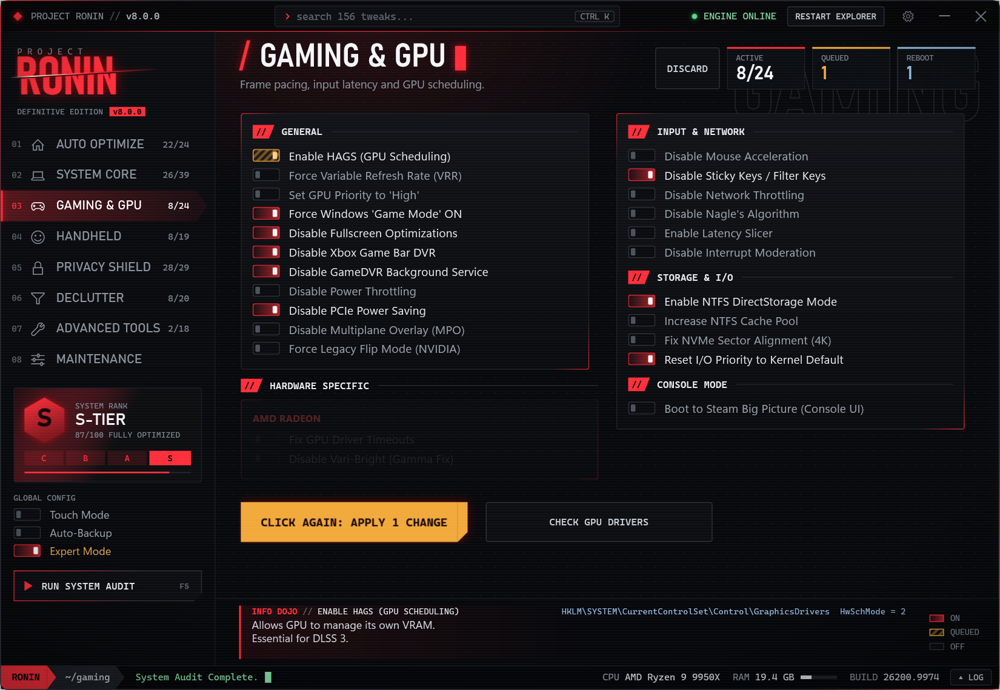

Flip a switch and it turns amber until you apply. The first Apply click shows what will change; the second applies it. Then a summary tells you what happened:

<p align="center">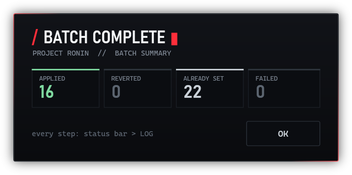</p>

---

## 🎮 Getting Around

* **Hover** any tweak to read what it does, and the exact registry value it writes, in the **Info Dojo** at the bottom. **Right-click** to pin the description.
* **Red switch = on. Amber = changed here, not applied yet.** **DISCARD** puts your changes back without touching the PC. Ronin skips anything that's already set, so re-running is safe.
* **Ctrl+K** searches every tab. **F5** re-runs the system audit.
* **Undo anything:** switch a tweak off and Apply, or use Maintenance → **Changes by Ronin** (one at a time, or all of them).
* **Settings** (gear icon, top right): which tab to open on, the apply preview, the Windows-update alert, and how Explorer restarts. Expert Mode, Touch Mode and Auto-Backup are remembered between launches.
* **Expert Mode** (bottom left) unlocks the riskier tweaks. Leave it off unless you know what you're changing.

> **Handheld?** ROG Ally, Legion Go, MSI Claw and Steam Deck are auto-detected. Ronin opens the Handheld tab with device-specific fixes.

---

## ⚠️ Known Limitations

* **English Windows is the tested configuration.** Applying, reverting and almost every status check work in any display language. Two checks (Compact OS and Reserved Storage) still read English command output, so on another display language they may show "not applied" when they are. Ronin tells you this at startup.
* **Some tweaks need an Explorer restart or a reboot to show.** Ronin restarts Explorer once at the end of a batch when a shell tweak changed, and shows a banner when a reboot is needed.
* **Vendor launcher tweaks (Armoury Crate, Legion Space, MSI Center M)** stop those apps auto-starting. On handhelds they can be what controls fan curves and TDP. If performance or fan behaviour changes, revert them; reverting restores each service's original startup type.

---

## 🗺️ Roadmap & Community

Honestly, the roadmap is whatever you want it to be. I built this to solve my own headaches. If there's a tweak or feature you want in Ronin, drop it in the **Issues** tab and I'll take a look.

---

## ❓ Frequently Asked Questions

**Will this break Windows Update?** No. Ronin never disables the update services. It kills the *annoyances* (forced auto-restarts, seeding updates to strangers via WUDO) and leaves the actual security patching alone. The Declutter tab can also pause updates the same way Settings does, or (Expert Mode) pause them for up to a year with a reminder every 30 days, and Settings' "Resume updates" button always turns them back on.

**Does Ronin connect to the internet?** Only when you ask it to. Install Apps and Install Visual C++ download through Microsoft's winget, after you confirm. No telemetry, no update checks, nothing in the background.

**My antivirus flagged it. Is it a virus?** No. Ronin edits deep Windows settings, which is exactly what heuristic scanners look for. There's no telemetry, no obfuscation, and every line of code is public in this repo for you to read. If your AV blocks it, that's a false positive you can report to Microsoft at <https://www.microsoft.com/wdsi/filesubmission>.

**Why not just use WinUtil?** I love WinUtil. But Ronin bundles things I always wished it had in one click: SSD health checks, a full GPU driver-stack reset, and deep handheld tuning. WinUtil is amazing, it just never had *everything* I wanted.

**Is this safe for Handhelds (MSI Claw, ROG Ally, Legion Go)?** That's the whole reason it exists. I'm a massive handheld fan, and Ronin auto-detects handheld hardware and opens a dedicated tab with Modern Standby fixes and custom EPP power slicing.

**Where are the logs?** Click the status bar at the bottom (or **LOG** on the right) for the full console, or Maintenance → **Logs & Backups** to open `C:\ProgramData\Ronin\`. Every action gets logged, and `Ronin_StateReport.txt` shows exactly which tweaks are on or off right now. Something went wrong? Maintenance → **Save Bug Report** zips all of it to your Desktop for an Issue.

---

<details>
<summary><b>🔧 For developers: building from source and code signing</b></summary>

Ronin ships as a single self-contained `Ronin.ps1` ("the monolith"), assembled from the sources in `src/` and `ui/` by `BuildRonin.ps1`. Edit the sources, never the root `Ronin.ps1`.

```powershell
.\BuildRonin.ps1            # rebuild the monolith from src/ + ui/
.\BuildRonin.ps1 -Run       # build, then launch
```

Signing (EV certificates clear SmartScreen immediately, OV builds reputation over time; signatures are RFC-3161 timestamped):

```powershell
.\Sign-Ronin.ps1 -SelfSignedTest                    # prove the pipeline with a throwaway cert
.\Sign-Ronin.ps1 -Thumbprint <YOUR_CERT_THUMBPRINT> # sign with a real cert
.\Sign-Ronin.ps1 -VerifyOnly                        # check the current signature
```

</details>

---

## ⚖️ Disclaimer

*Project Ronin is open-source and shared as-is under the MIT License. I built it for myself and run it on my own machines, but system-level tweaking always carries some inherent risk. Keep a backup of anything you can't afford to lose.*
